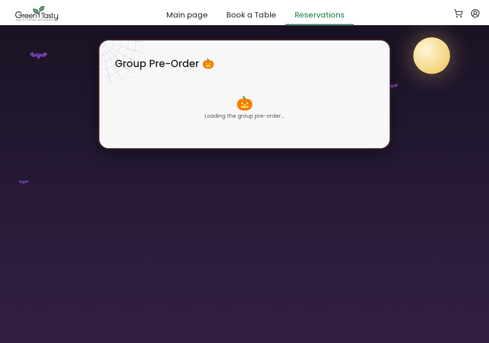
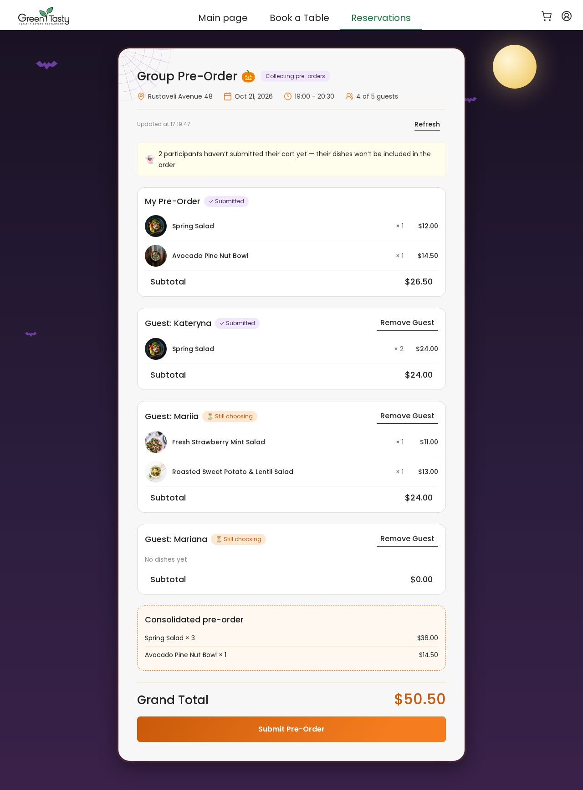
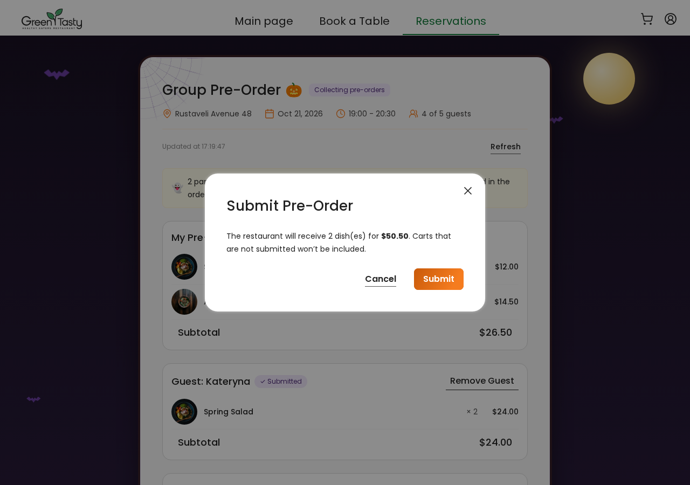
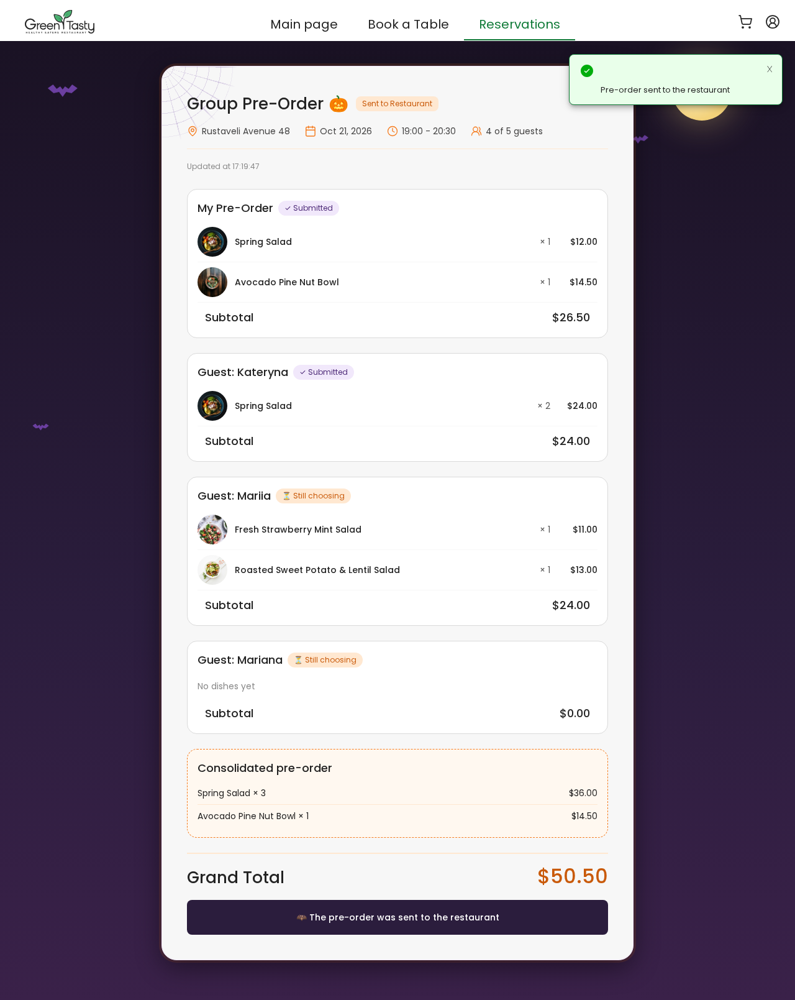
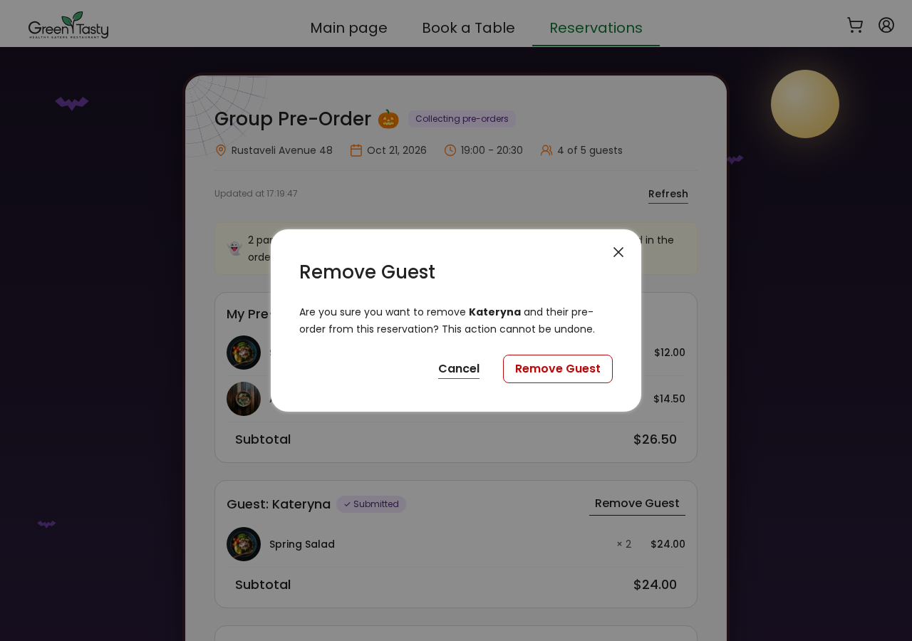
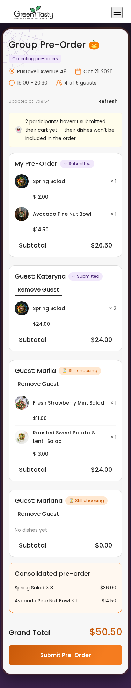
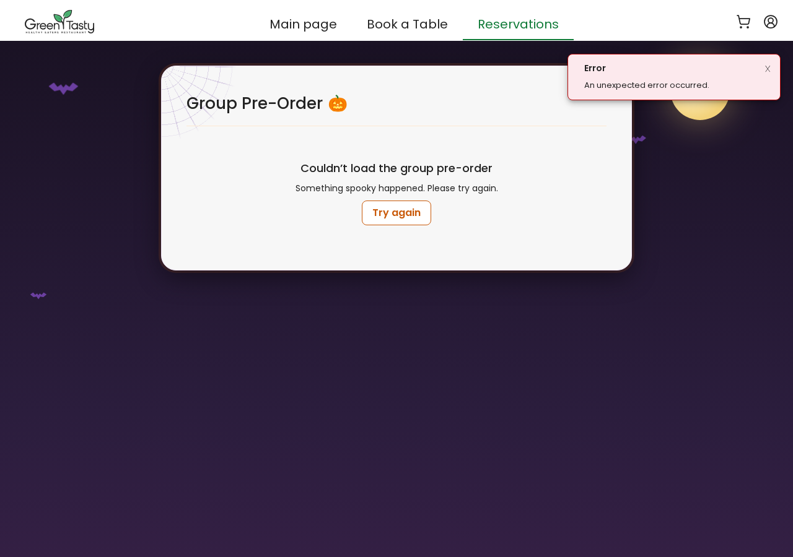

# Завдання 6. Frontend: екран Owner групового pre-order

Owner бачить, що обрав кожен гість, і відправляє в ресторан одне спільне замовлення.
Виконано **рівні 1, 2, 3 і бонус Remove Guest**. Стиль хелловінський: розкладка, тексти й елементи
такі самі, як у макеті Figma (Owner Flow), змінено лише палітру (гарбузовий і фіолетовий замість зеленого)
і додано декор (нічне небо з місяцем і кажанами, павутинка).

Код: [`marathon2026/frontend/restaurant-frontend-app`](marathon2026/frontend/restaurant-frontend-app).
Демо на моках: `npm ci && npm start`, далі
`http://localhost:4200/reservations/demo-reservation/group-order?demo`.

## Що зроблено

| Рівень | Що реалізовано |
|---|---|
| Практичне + 1 | Картка учасника `ParticipantCardComponent`: «My Pre-Order» / «Guest: Name», страви з фото або першою літерою, `× qty`, ціна, Subtotal, статус кошика текстом (Submitted / Still choosing). Сторінка `GroupOrderPageComponent` з маршрутом `/reservations/:reservationId/group-order`. Шапка (адреса, дата, час, «N of M guests»), семантика `<main>` / один `<h1>` / `<ul><li>` / `<article>`, адаптив до 375 px. |
| 2 | `GroupOrdersService` з методами `getGroupInvite$`, `getSessions$`, `getOwnerSessionId$`, `getStatus$`, `submit$`. Стан на `signal()`, похідні значення на `computed()`. Блок «Consolidated pre-order» через `consolidatePreOrder()`. **Grand Total = сума лише підтверджених кошиків.** Жовта плашка про непідтверджених учасників, бейдж «Collecting pre-orders» / «Sent to Restaurant». Submit через `<app-modal>` із захистом від подвійного кліку. Стани: loading, error з «Try again», 404 «Group reservation not found», empty. |
| 3 | Фонова синхронізація кожні 15 с, поки група `Open` (`interval` + `exhaustMap`, тож новий запит не стартує, поки не завершився попередній). Тихі запити `{ silent: true }` через `SKIP_ERROR_TOAST`. «Updated at HH:mm:ss», кнопка «Refresh», при помилці «Couldn’t refresh. Showing data from …». Таймер не дублюється при «Try again», зупиняється після Submit і при виході зі сторінки. |
| Бонус | `removeSession$`, кнопка «Remove Guest» з `aria-label="Remove Name"` лише в гостей і лише поки група Open, діалог підтвердження, оновлення списку й сум з відповіді сервера. |
| Дод. | Кнопка «Group Pre-Order» на картці бронювання (макет 03): з'являється, коли бронювання в статусі Reserved і гостей 2 або більше, і веде на екран Owner. |

Бекенд для рівня 3 (усі 4 ендпоінти) зроблено в завданні 5, у тому ж репозиторії: `marathon2026/backend`.

## Скріни станів

| Стан | Скрін |
|---|---|
| Завантаження |  |
| Owner Review (група Open) |  |
| Діалог Submit |  |
| Відправлено в ресторан (read-only) |  |
| Діалог Remove Guest |  |
| Телефон, 375 px |  |
| Помилка + «Try again» |  |

## Використання AI

Так, під час роботи використовувався AI-асистент (Claude Code). Він допоміг:
- прочитати умови й тести;
- написати код компонентів, сервісу та стилів;
- прогнати перевірки й зняти скріни.

Готові тести з `homework-tests/` не змінювались: їх скопійовано в `src/app/` як є, і `diff` з оригіналами показує, що файли ідентичні.

## Як перевірено

Усі чотири перевірки з `homework-frontend.md`:

```bash
npx tsc -p tsconfig.app.json  --noEmit          # OK
npx tsc -p tsconfig.spec.json --noEmit          # OK
BACKEND_URL=https://example.com npm run build   # Bundle check passed; стилі нових компонентів у межах бюджету 4 kB
npm run test:hw                                 # TOTAL: 67 SUCCESS (practice + level 2 + level 3 + bonus + helpers)
```

Окремо пройшли тести картки бронювання з новою кнопкою «Group Pre-Order» (3 SUCCESS).
Скріни зняті в headless Chrome з dev-сервера на мок-бекенді (`?demo`).
